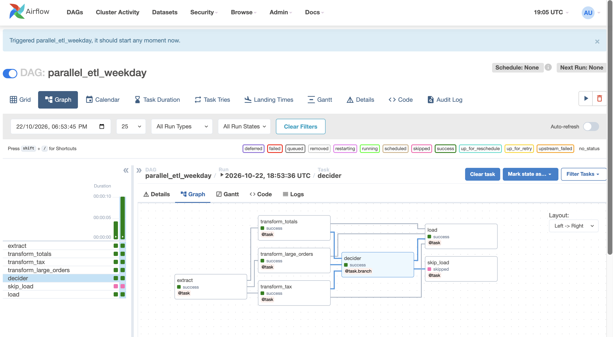

# Airflow ETL Practice

Hands-on Apache Airflow practice project: building a data pipeline that extracts, transforms, and loads sales data, with parallel tasks and a weekday branch.

## Tech Stack
- Apache Airflow 2.7.3 (Docker)
- PostgreSQL 13 (Airflow metadata database)
- Python 3.11, pandas-free CSV processing

## DAGs in this repo
- **parallel_simple**: extract → three transforms in parallel → load
- **parallel_etl_weekday**: extract → three transforms in parallel → decider (weekday check) → load or skip_load

## Pipeline graph

## How to run
1. Start Airflow: `docker compose up -d`
2. Open http://localhost:8080 (login: admin / admin)
3. Turn on a DAG and click **Trigger**.

## Notes
- Secrets are kept in `.env`, which is not committed.
- Output CSV files are written to `data/`, which is not committed.
